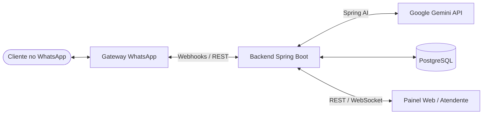

# Chatbot de Atendimento com IA para WhatsApp

> **Projeto Integrador (PI)** — Faculdade de Tecnologia do Estado de São Paulo (Fatec)

---

## 📌 Visão Geral do Projeto

Este projeto tem como objetivo desenvolver uma solução inteligente de atendimento automatizado via **WhatsApp** para empresas, utilizando **Inteligência Artificial Generativa (LLM)** para otimizar a comunicação com clientes e reduzir a sobrecarga operacional de equipes de atendimento humano.

A plataforma automatiza a triagem e resolução de dúvidas frequentes com respostas contextuais, cordiais e personalizadas, contando com mecanismo de **transbordo humano** para transferir atendimentos complexos a operadores em tempo real.

---

## 🎯 Metas e Objetivos (SMART)

* **Específico:** Automatizar o primeiro atendimento e entregar respostas claras, rápidas e contextualizadas usando IA.
* **Mensurável:** 
  * Reduzir o tempo médio de primeira resposta para **menos de 1 minuto**.
  * Automatizar a resolução de ao menos **70% das dúvidas frequentes (FAQ)**.
* **Atingível:** Integração de gateway de WhatsApp com LLM orquestrado via **Spring AI** alimentado com o contexto do negócio.
* **Relevante:** Aumento na satisfação do consumidor, retenção de clientes e otimização do tempo da equipe de suporte.
* **Temporal:** Desenvolvimento, validação e testes ao longo do semestre letivo do Projeto Integrador.

---

## ✨ Funcionalidades Principais

- [x] **Recepção e Envio de Mensagens:** Comunicação bidirecional integrada via Webhooks com gateway de WhatsApp.
- [ ] **Processamento com IA Generativa:** Compreensão de linguagem natural (PLN) e geração de respostas contextualizadas com o modelo Google Gemini.
- [ ] **Base de Conhecimento Customizável:** Configuração de regras de negócio, dados institucionais e FAQs por empresa.
- [ ] **Painel de Transbordo Humano:** Detecção de casos complexos ou solicitação explícita do cliente com transferência imediata para atendente humano.
- [ ] **Painel Administrativo:** Dashboard para acompanhamento de métricas, histórico de conversas e cadastro de informações da empresa.

---

## 🏗️ Arquitetura do Sistema



---

## 🛠️ Tecnologias Utilizadas

### Backend
* **Linguagem:** Java 21
* **Framework:** Spring Boot 4.x / 3.x
* **Inteligência Artificial:** Spring AI (`spring-ai-starter-model-google-genai`)
* **Persistência de Dados:** Spring Data JPA / Hibernate
* **Banco de Dados:** PostgreSQL
* **Gerenciador de Dependências:** Maven

### Integração WhatsApp
* Gateway de Mensageria com suporte a Webhooks (ex: Evolution API / Meta Cloud API)

### Frontend *(em desenvolvimento)*
* Painel de Atendimento e Configurações (Dashboard & Transbordo)

---

## 📁 Estrutura do Repositório

```text
projeto-pi/
├── backend/
│   └── chatbot-whatsapp/      # API REST em Spring Boot com Spring AI
│       ├── src/               # Código-fonte Java e configurações
│       ├── pom.xml            # Dependências Maven
│       └── mvnw / mvnw.cmd    # Maven Wrapper
├── frontend/                  # Interface web para atendentes e gestão
└── README.md                  # Documentação do projeto
```

---

## 🚀 Como Executar o Projeto Localmente

### Pré-requisitos
* **Java 21** instalado
* **PostgreSQL** instalado e em execução (ou via Docker)
* Chave de API do **Google Gemini** (`GEMINI_API_KEY`)

### Passo a passo (Backend)

1. **Clone o repositório:**
   ```bash
   git clone https://github.com/SEU-USUARIO/SEU-REPOSITORIO.git
   cd projeto-pi/backend/chatbot-whatsapp
   ```

2. **Configure as variáveis de ambiente:**
   Defina as credenciais do banco e a chave da IA (via variáveis de ambiente ou no `application.properties`):
   ```properties
   spring.datasource.url=jdbc:postgresql://localhost:5432/chatbot_db
   spring.datasource.username=seu_usuario
   spring.datasource.password=sua_senha
   spring.ai.google.genai.api-key=SUA_CHAVE_GEMINI
   ```

3. **Compile e execute a aplicação:**
   * No Windows:
     ```powershell
     .\mvnw.cmd spring-boot:run
     ```
   * No Linux/Mac:
     ```bash
     ./mvnw spring-boot:run
     ```

---

## 👥 Equipe do Projeto

Davi Soares 

Douglas Pacheco

Pierry Savio

---

## 📄 Licença

Este projeto é desenvolvido para fins acadêmicos.
